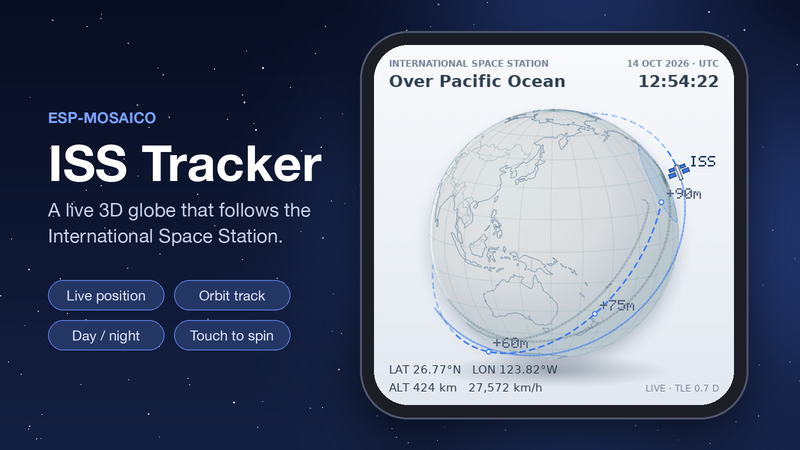

# ESP-Mosaico Apps

Two applications for the ESP-Mosaico board (ESP32-S31):

| App | What it does |
| --- | --- |
| [**Budgie AI**](projects/budgie_ai) | Voice and chat AI assistant. Talk or type, browse chat history, and use any OpenAI-compatible service. UI built with LVGL Pro. |
| [**ISS Tracker**](projects/iss_tracker) | Live 3D globe that follows the International Space Station, with its orbit track, day/night shading and touch to spin. |

<p>
  
  
</p>

This repository holds only the application folders. They build inside the
official ESP-Mosaico workspace, which provides the CLI, the board support
package, Vibe Mode integration and the build scripts.

## Quick install (no build needed)

Download the app's `.irisfw` file from the [`release/`](release) folder. Then, from
the official workspace root (step 1 below), with the board connected by USB:

```sh
python mosaico.py iris system-update --bundle budgie_ai-system-update.irisfw
```

A new or blank board needs `python mosaico.py recover` once first.

To watch the device in your browser, run `python mosaico.py iris run` and open
the printed web workbench URL. `python mosaico.py iris logs` shows live logs.

## Build from source

### 1. Get the official workspace

Clone the official [ESP-Mosaico Vibe](https://github.com/esp-mosaico/esp-mosaico-vibe) workspace and initialise its submodules:

```sh
git clone https://github.com/esp-mosaico/esp-mosaico-vibe.git espMosaico
cd espMosaico
git submodule update --init submodule/esp-mosaico-utils submodule/esp-mosaico-bsp
```

The submodules are
[esp-mosaico-utils](https://github.com/esp-mosaico/esp-mosaico-utils) and
[esp-mosaico-bsp](https://github.com/esp-mosaico/esp-mosaico-bsp). Follow the
workspace README to set up Python 3.10+ and ESP-IDF at commit
`7b9cc1ac79f865983f59bb8ff3ff43eb74ff1dbe` for target `esp32s31`.

### 2. Add the apps

Copy one or both folders from this repository's `projects/` into the
workspace's `projects/`:

```
espMosaico/
├── mosaico.py
├── submodule/
│   ├── esp-mosaico-utils/
│   └── esp-mosaico-bsp/
└── projects/
    ├── budgie_ai/      ← from this repository
    └── iss_tracker/    ← from this repository
```

The apps find the workspace through relative paths (`../../submodule/...`),
so they must sit exactly at `projects/<name>`.

### 3. Build and install

Connect the board by USB, then from the workspace root:

```sh
python mosaico.py iris system-update --project projects/budgie_ai
python mosaico.py iris system-update --project projects/iss_tracker
```

Use `system-update` for the first install. The ISS Tracker can also be previewed
on the PC first:

```sh
python mosaico.py project sim --project projects/iss_tracker --interactive
```

See each app's README for setup, controls and how it works.

## Repository layout

```
projects/
├── budgie_ai/
│   ├── main/            app logic: assistant, UI glue, chat history
│   ├── components/      AI client, audio, Wi-Fi, web setup page, settings, camera
│   ├── ui/budgie_ui/    LVGL Pro project (open in LVGL Editor)
│   ├── tests/ui_host/   UI checks and screenshots on the PC
│   └── media/           cover and screenshots
└── iss_tracker/
    ├── main/            SGP4 orbit maths, globe renderer, networking
    ├── pc/              simulator backend
    ├── ui/              GSP screen, fonts and images
    ├── tools/           world map generator and source data
    └── media/           cover
```

## License

Apache License 2.0, see [LICENSE](LICENSE).

Third-party assets keep their own licenses:

- Inter font (Budgie): SIL Open Font License 1.1,
  [`LICENSE-Inter.txt`](projects/budgie_ai/ui/budgie_ui/fonts/LICENSE-Inter.txt)
- DejaVu fonts (ISS Tracker): [`ui/fonts/LICENSE`](projects/iss_tracker/ui/fonts/LICENSE)
- World map (ISS Tracker): world-atlas, ISC license, derived from Natural Earth
  (public domain), see [`tools/data`](projects/iss_tracker/tools/data)
