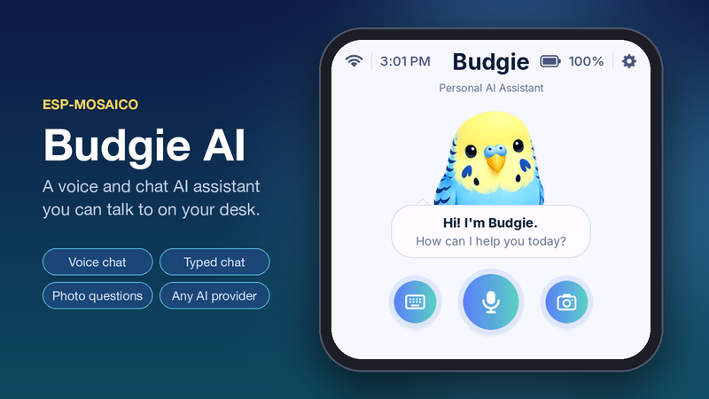
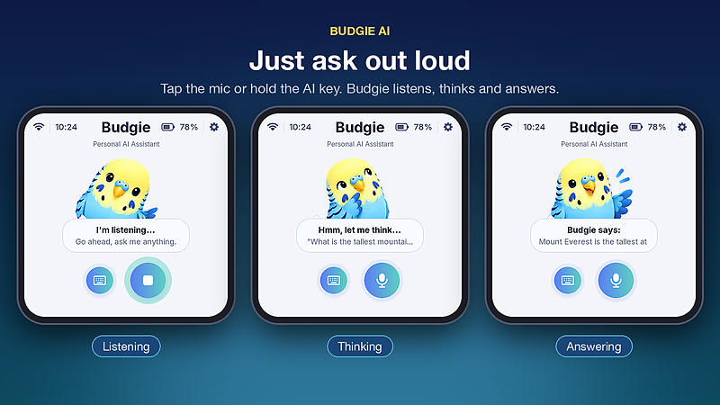
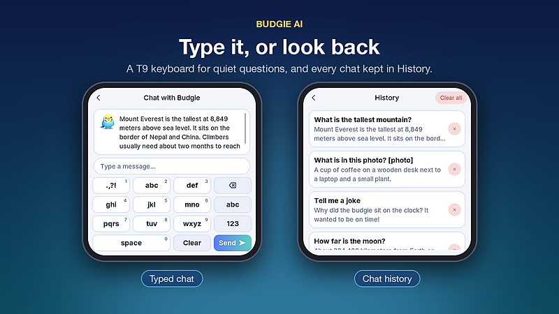
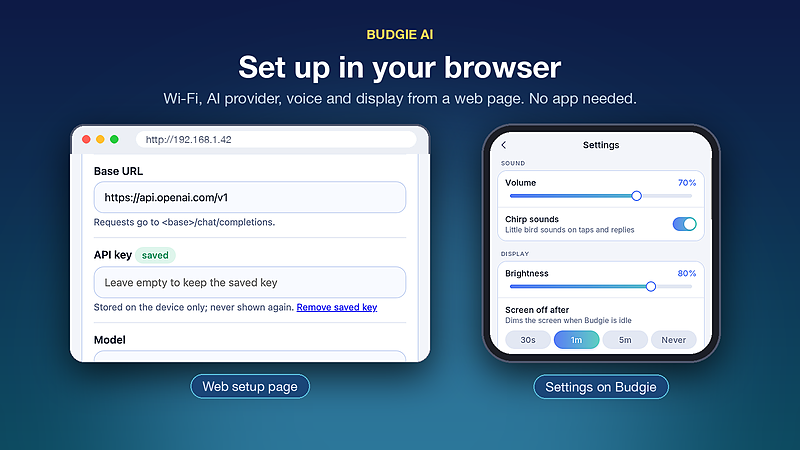

# Budgie AI

A voice and chat AI assistant for ESP-Mosaico. Ask out loud and Budgie
answers on screen and through the speaker. Works with any OpenAI-compatible
service: OpenAI, OpenRouter, Groq, DeepSeek, Ollama, LM Studio and others.



## Features

- **Voice chat:** speak, and Budgie replies on screen and out loud.
- **Typed chat:** a T9 keyboard for quiet questions.
- **Chat history:** tap the idle bubble to see past chats.
- **Memory:** remembers recent messages, so follow-up questions work.
- **Web setup page:** Wi-Fi, AI provider, voice and display from your phone.
- **UI built with LVGL Pro:** screens in `ui/budgie_ui`, editable in LVGL Editor.
  [**View the UI in your browser**](https://viewer.lvgl.io/?repo=https://github.com/nishad2m8/mosaico-apps/tree/main/projects/budgie_ai/ui/budgie_ui)





## Install

From the workspace root, with the board connected by USB:

```sh
# Option A: prebuilt firmware from the repo's release/ folder
python mosaico.py iris system-update --bundle budgie_ai-system-update.irisfw

# Option B: build from source
python mosaico.py iris system-update --project projects/budgie_ai
```

A new or blank board needs `python mosaico.py recover` once first.

## Web monitor and logs

```sh
python mosaico.py iris run --project projects/budgie_ai    # prints a web workbench URL
python mosaico.py iris logs --project projects/budgie_ai   # live device logs
```

Open the printed URL in your browser to watch the device. Press Ctrl+C to stop.

## First setup

1. Budgie starts a Wi-Fi network named **`Budgie-XXXX`** (shown on screen).
2. Join it from your phone. The setup page opens, or go to **http://192.168.4.1**.
3. Under **Wi-Fi**, pick your network and tap **Connect**.
4. Open the new address shown in *Settings → Web setup*.
5. Pick a **Provider**, paste your **API key**, tap **Test & load models**,
   then **Save settings**.

If Vibe Mode already has Wi-Fi saved, Budgie uses it.

## Controls

| Input | Action |
| --- | --- |
| Mic button | Tap to listen, tap again to send |
| **AI key** | Hold to talk, release to send. Press while Budgie talks to stop it |
| Keyboard button | Typed chat |
| Idle bubble | Chat history |
| **Boot key** | Stop and go home |
| **Power key** | Power on/off |

## Good to know

- Your API key is saved on the device only and never shown again.
- The setup page has no login. Anyone on the same network can change settings.
- Spoken replies need a provider with speech endpoints. Otherwise turn off
  **Speak replies**.
- Your AI service may charge for use.

## Developers

- `main/`: assistant, UI glue, chat history
- `components/`: AI client, audio, Wi-Fi, web setup, settings
- `ui/budgie_ui/`: LVGL Pro project
  ([open in LVGL Viewer](https://viewer.lvgl.io/?repo=https://github.com/nishad2m8/mosaico-apps/tree/main/projects/budgie_ai/ui/budgie_ui))
- `tests/ui_host/run.sh render`: UI checks and screenshots on the PC
